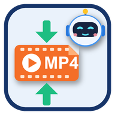

# 小柯機器人MP4影片壓縮工具

影片、圖片、音訊一鍵壓成小檔案。完全在自己的電腦上處理，不會上傳。

- **影片**：品質優先（高畫質／均衡／小檔案／極小）、**指定檔案大小**（兩趟精準壓縮，太小時自動降解析度）、原檔比例；H.264／H.265／VP9／AV1；解析度、影格率、聲音、修剪片段、移除 GPS 等拍攝資訊
- **硬體加速**：自動偵測 NVIDIA NVENC、Intel Quick Sync、AMD AMF
- **圖片**：JPG、WebP、PNG（減色，類似 pngquant）、縮小尺寸
- **音訊**：MP3、M4A、Opus，位元率、單聲道
- **批次**：一次拖進很多檔案或整個資料夾
- **比較**：壓縮前後左右拖曳比較畫質，可放大看細節
- **語音動態教學**：小柯機器人一步一步示範
- **自動更新**

## 平台

| 平台 | 狀態 |
| --- | --- |
| Windows 11 | v1.0.0 |
| macOS | 規劃中 |
| 線上版（網頁） | 規劃中 |
| iPhone／iPad（線上安裝） | 規劃中 |
| Android | 規劃中 |

## 授權

MIT。壓縮由內附的 [FFmpeg](https://ffmpeg.org/)（GPL）執行，詳見 [THIRD_PARTY_NOTICES.md](THIRD_PARTY_NOTICES.md)。
構想參考 [CompressO](https://github.com/codeforreal1/compressO)，程式碼全部自行撰寫。

開發：吳玉柱 先生 與 Claude AI Opus 5.5
